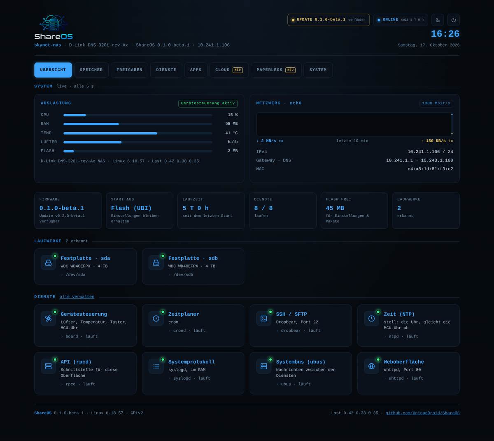

# ShareOS

ShareOS is a free, open source alternative firmware for the D-Link
DNS-320L (and, later, the DNS-320/321/323/325/327L, DNR-322L and
compatible NAS boxes).

It is a fork of [Alt-F](http://sourceforge.net/projects/alt-f) by João
Cardoso. All credit for the original design, the hardware support and
years of work goes to the Alt-F project — see [LICENSE](LICENSE) and
[COPYING](COPYING) for the GPLv2 terms.

> **Built by an AI.** Apart from importing Alt-F, ShareOS was developed by
> Claude (Anthropic): architecture, all code, builds, tests and docs. Jan
> started the project, made the decisions and tested on the real box.
> Timeline with timestamps and screenshots:
> **[docs/DEVELOPMENT.md](docs/DEVELOPMENT.md)** ([Deutsch](docs/ENTWICKLUNG.md)).
>
> Testing and installing: [docs/TESTING.md](docs/TESTING.md) ([Deutsch](docs/TESTEN.md)).
> Translating the web interface: [docs/TRANSLATING.md](docs/TRANSLATING.md).



## Status: runs from flash on the DNS-320L – storage in progress

ShareOS is being rebuilt on a current, maintainable base while keeping
what made Alt-F easy to use: the stock U-Boot, the stock flash layout and
installing from the vendor web interface.

| | Alt-F (legacy) | ShareOS |
|---|---|---|
| Build system | buildroot 2009.08 fork | buildroot 2026.02 LTS, `BR2_EXTERNAL` tree |
| Toolchain | GCC 7.4, uClibc-ng | GCC 14, musl |
| Kernel | 4.14 (EOL) | 6.18 LTS |
| Configuration | scattered files, shell CGIs | UCI + ubus/rpcd/ucode |
| Updates | manual upload | GitHub Releases (verified, not yet tested on hw) |

The current image is a **test system**: SSH, a hardware check and the new
backend (UCI, ubus, rpcd + ucode, uhttpd) with the GitHub release updater –
see [docs/BACKEND.md](docs/BACKEND.md). The web interface is still a test
page. On the DNS-320L, testing on real hardware needs the serial console,
see [docs/HARDWARE-DNS320L.md](docs/HARDWARE-DNS320L.md); the backend can be
run on a build host with qemu (`tests/run-stack-qemu.sh`).

## Layout

```
configs/                 buildroot defconfigs (shareos_<board>_defconfig)
board/dlink/dns320l/     device tree, kernel fragment, rootfs overlay, image scripts
package/                 ShareOS buildroot packages
src/alt-f-utils/         Alt-F device tools (MCU daemon, dns323-fw, sysctrl)
patches/                 hashes/patches for buildroot packages
src/shareos-core/        backend: rpcd ucode plugin, updater, UCI defaults, init scripts
tests/                   host tests (updater, qemu stack)
scripts/                 helper scripts
legacy/alt-f/            the original Alt-F tree, kept for reference
```

## Building

See [docs/BUILD.md](docs/BUILD.md). In short:

```sh
make dns320l
# -> output/dns320l/images/ShareOS-<version>-DNS-320L-rev-Ax.bin
```
