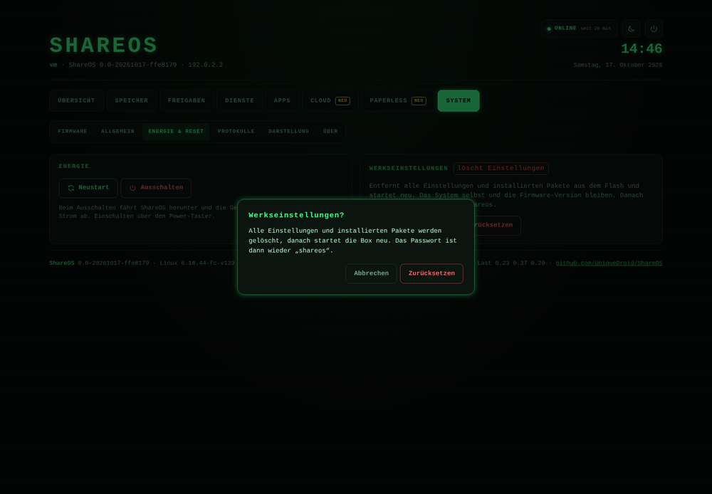
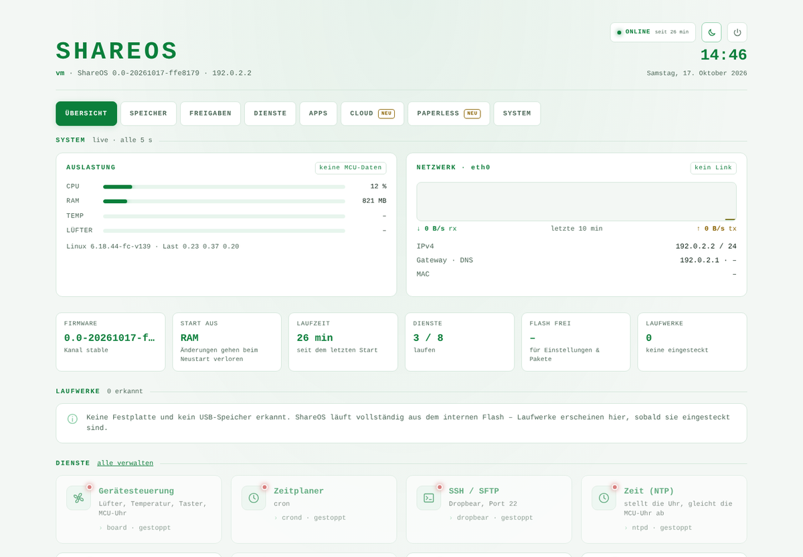

# How ShareOS was built – an AI development log

*Deutsche Version: [ENTWICKLUNG.md](ENTWICKLUNG.md)*

ShareOS was developed almost entirely by an AI: **Claude** (Anthropic).
Jan started the project and steered it as a "vibe coder": he set the goals,
made the fundamental decisions and tried everything on the real hardware.
The analysis, the architecture, all of the code, the builds, the tests, the
debugging and this documentation come from Claude.

This document records, with timestamps, how that went. It shows how far an
AI got in October 2026 with real embedded development: old hardware, a
bootloader that must not be changed, and no debugger except a serial console.

*Each dot is a commit (times in CEST). Generated from the git history by
`scripts/zeitstrahl.py`.*

## Who did what

| | Jan (initiator) | Claude (AI) |
|---|---|---|
| Goals & direction | Modernise Alt-F, a web UI in the style of his intranet, updates from GitHub, cloud, Paperless | Proposals with trade-offs (OpenWrt vs. Alt-F base, CGI vs. rpcd/ucode, partitioning) |
| Decisions | "Replace the old UI completely", "foundation first", "no OpenWrt", "no soldering", a wizard *and* a manual path | – |
| Code | 1 commit: importing Alt-F | 26 commits, about 5,500 new lines (build system, device tree, init, updater, backend, web UI, tests, docs) |
| Hardware | Connected the serial adapter, drove U-Boot, ran commands, sent back logs, installed the disks | Specified every command, read every log, found the causes |
| Tests | The real box (DNS-320L rev A3) | Emulator (qemu-user), test suites with a simulated box and virtual disks |

Once, "Konrad", Jan's local Claude instance, also helped: it looked directly on
the box for why the web server was not running.

## Timeline

### Friday, 16 Oct 2026 – from concept to a new base

| Time | Event |
|---|---|
| ~16:00 | Jan creates the project and imports Alt-F (r3935) into the repo as ShareOS. |
| ~16:20 | **UI concept**: Claude analyses Alt-F's 178 CGI scripts and groups them into 8 areas. The design takes its style from Jan's Skynet intranet. |
| ~16:55 | **Modernisation plan**: inventory (buildroot 2009, kernel 4.14 EOL, uClibc). Decision with Jan: modernise the Alt-F base and adopt OpenWrt's operating model (UCI, ubus, rpcd, ucode), because OpenWrt itself could only be installed through the serial console. |
| 17:10 | **New build base**: buildroot 2026.02 LTS as BR2_EXTERNAL, GCC 14, musl, kernel 6.18 with a ported DNS-320L device tree. |
| 19:10 | The kernel is too big (4.2 MB); the stock U-Boot only loads 3 MB. With xz and a leaner config it fits (2.1 MB). |
| 19:54 | Test through Alt-F's "TryIt"/kexec: the box hangs, even with Alt-F's own kernel. Claude finds the Alt-F author's confirmation that kexec does not work on the DNS-320L. **No way forward without a serial console.** |
| 21:25 | **Core stack**: UCI, ubus, rpcd with a ucode plugin, uhttpd and an updater for GitHub releases, fully tested in the emulator. |

### Saturday, 17 Oct 2026 – on the real hardware

| Time | Event |
|---|---|
| ~11:00 | Jan connects a USB-TTL adapter to the unpopulated header JP1, without soldering. Claude guides him through the pinout, swapped RX/TX wires and a loose ground. |
| ~12:15 | Stopping autoboot does not work. Claude finds the D-Link quirk in the U-Boot code: **space, then 1**. |
| ~12:30 | TFTP timeouts: the cause is the firewall (ufw) on Jan's PC. |
| 12:44 | **ShareOS boots on the box for the first time**, from RAM, without flashing anything. Gigabit, MAC address, fan, temperature, buttons and the web interface all work. |
| 12:57 | **UBI layout**: the system as squashfs, settings as a UBIFS overlay, a small initramfs with a rescue mode. |
| 13:48 | System written to flash. The settings survive a reboot. The fix for a clean shutdown is in place. |
| 14:11 | Kernel and initramfs flashed: **the box boots ShareOS on its own**, without a PC or console. The Alt-F partitions were backed up first. |
| 14:47 | **Updater for the new layout** and **new web interface** in Skynet style. |
| 15:00–15:44 | The web interface is gone after every boot. Debugging with Jan and Konrad. Claude reproduces the crash in the emulator: every browser request with `If-Modified-Since` crashes `uhttpd` (musl `strptime` with `%Z`). Fixed with a patch. |
| 15:51 | The disks are detected. This confirms the SATA power line that was corrected during porting (gpio0 24 instead of Alt-F's gpio1 24). |
| 16:00 | **Storage**: wizard and manual management (ext4, RAID 1, SMART, spindown, swap, app area). |

## Notable problems solved

- **The bootloader's 3 MB limit:** the kernel shrank from 4.2 to 2.4 MB, with drivers moved to modules. The initramfs is only 0.9 MB.
- **No flashing without a way back:** first ShareOS ran from RAM, then from the network, then the system went into flash, and the kernel came last. Every step had a way back (Alt-F backup, D-Link rescue system, rescue mode).
- **U-Boot without documentation:** Claude worked out the abort sequence and the fallback to the rescue system on a broken image from the bootloader's behaviour and memory dump.
- **A hardware detail in the device tree:** Alt-F switched the SATA power through the wrong GPIO controller. Claude caught it while porting; the disks confirmed it.
- **A crash that only happened in a real browser:** the safeguard (automatic uhttpd restart, logging) came first. The actual cause was a bug in the C library, which Claude reproduced in the emulator and worked around.

## The web interface

| Login | Overview |
|---|---|
|  |  |

| Firmware update | Confirmation |
|---|---|
|  |  |

| Light theme | Phone |
|---|---|
|  |  |

*Screenshots from the emulator. Values such as temperature, fan and network
traffic do not exist there, which is also why the "not running from flash"
notice appears.*

## Numbers (as of 17 Oct 2026, 16:00)

- Working time: about 6 hours on Friday and 5 hours on Saturday
- 27 commits, 26 of them by Claude
- about 5,500 new lines: build/board 1,300, backend + web UI 2,900, tests 370, docs 500
- 18 updater tests (including a complete install on a simulated box), 21 interface checks in the ARM emulator, storage tests with virtual disks
- 0 solder joints, 0 bricked boxes

## How the work was done

Jan wrote in a chat, in German, what he wanted or what he was seeing; often
that was just a pasted console log. Claude worked in a cloud environment with
the repository: it built the firmware, tested it in the emulator, pushed to
GitHub and sent Jan the finished images with exact step-by-step instructions.
Everything that changed the box (flashing, erasing disks) happened only after
Jan's explicit OK.
