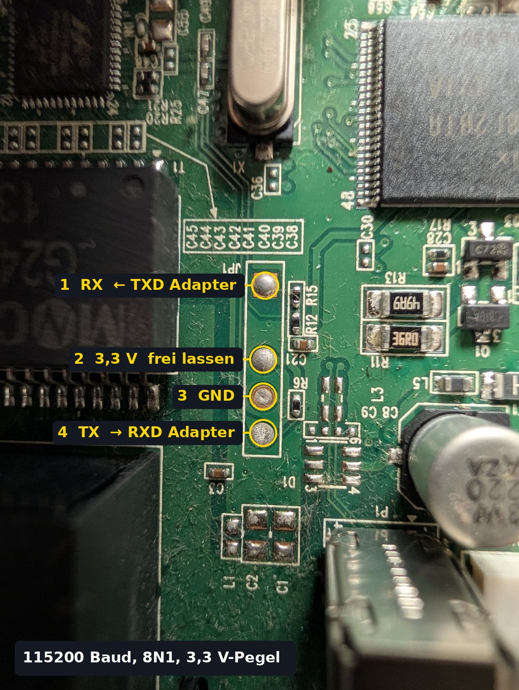
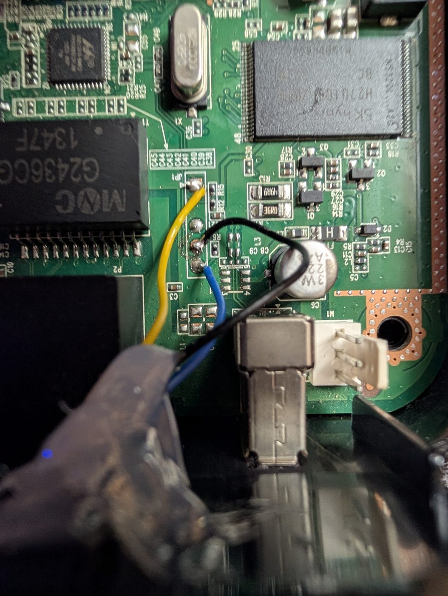
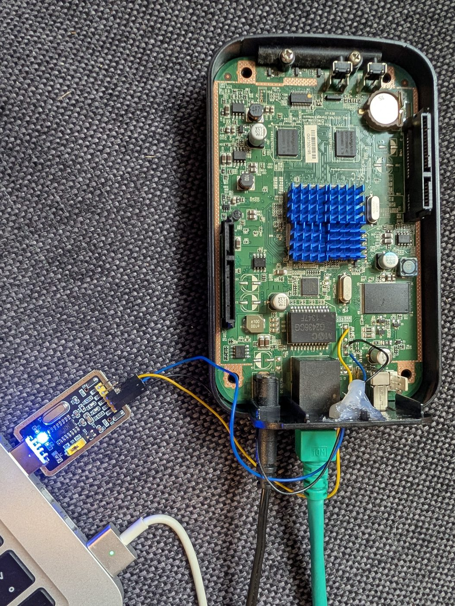
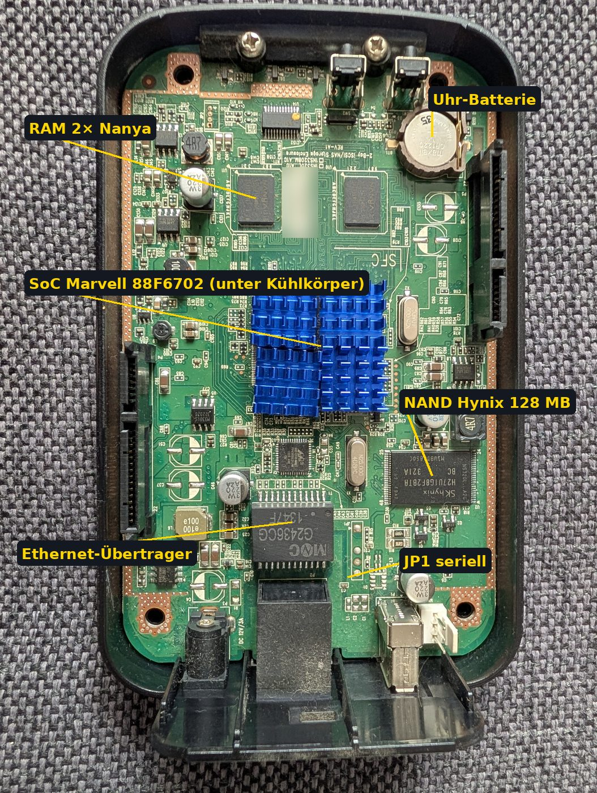

# ShareOS testen und installieren (DNS-320L)

*English version: [TESTING.md](TESTING.md)*

Stand: 18.10.2026. ShareOS ist in der **Testphase**. Es gibt zwei Wege zur
Installation:

- **Weg A – über die Firmware-Seite von Alt-F oder D-Link** (ohne serielle
  Konsole, ab 0.1.0-beta.7). Auf echter Hardware noch nicht erprobt: beim
  ersten Mal am besten die serielle Konsole als Rückfallebene anschließen.
- **Weg B – über die serielle Konsole** (Stiftleiste JP1, ohne Löten, siehe
  [HARDWARE-DNS320L.md](HARDWARE-DNS320L.md)): erprobt, Schritte 1–3 unten.

Ist ShareOS einmal installiert, laufen Updates über die Weboberfläche. Zurück
zu Alt-F geht ebenfalls über die Weboberfläche (siehe
[Zurück zu Alt-F](#zurück-zu-alt-f)).

## Weg A: über die Firmware-Seite von Alt-F oder D-Link

Aus dem GitHub-Release brauchst du:

- `ShareOS-<version>-DNS-320L-rev-Ax.bin` (Kernel und Startsystem, ca. 3,3 MB)
- empfohlen: `ShareOS-<version>-DNS-320L-rev-Ax.sysupgrade.tar` auf einem
  USB-Stick (FAT32, exFAT oder ext4; oberste Ebene oder Ordner `shareos`).
  Ohne Stick lädt die Box das Paket selbst von GitHub – dafür muss das
  Netzwerkkabel stecken und der Router per DHCP eine Adresse vergeben.

1. Den USB-Stick mit dem Paket in die Box stecken (falls vorhanden).
2. In der Weboberfläche von Alt-F (bzw. der D-Link-Firmware) auf der
   Firmware-Seite die ShareOS-`.bin` auswählen und flashen. Alt-F schreibt
   dabei nur Kernel und Startsystem.
3. Die Box startet neu. ShareOS merkt, dass noch kein System im Flash ist, und
   installiert es: zuerst vom USB-Stick, sonst von GitHub (Prüfsumme wird
   kontrolliert). Die **orange USB-LED blinkt schnell**, das dauert einige
   Minuten. Die Zusatzpakete von Alt-F im Flash werden dabei ersetzt.
4. Danach startet die Box von selbst neu – jetzt mit ShareOS. Weiter mit
   [4. Weboberfläche](#4-weboberfläche).

Klappt die Installation nicht (kein Stick, kein Netz, Paket defekt), bleibt
die Box im **Rettungsmodus** (orange USB-LED blinkt langsam). Der Grund steht
auf der seriellen Konsole und per SSH (`ssh root@<ip>`, Passwort `shareos`) in
`/tmp/firstinstall.err`, das Protokoll in `/tmp/firstinstall.log`. Abhilfe:
Paket auf einen USB-Stick kopieren, einstecken, Box aus- und wieder
einschalten.

## Weg B: über die serielle Konsole

### Was du brauchst

- das Update-Paket `ShareOS-<version>-DNS-320L-rev-Ax.sysupgrade.tar` aus einem
  GitHub-Release
- einen USB-TTL-Adapter (3,3 V) an JP1: Pin 4 = TX der Box, 3 = GND, 1 = RX der
  Box; Pin 2 (3,3 V) bleibt frei. Einstellung 115200 8N1
- einen PC mit TFTP-Server, zum Beispiel `dnsmasq`

### Serielle Konsole anschließen (ohne Löten)

JP1 sitzt neben dem USB-Anschluss und ist nicht bestückt. Es reicht, die
Drähte des Adapters (Dupont-Kabel) durch die Lötaugen zu stecken und mit etwas
Heißkleber zu sichern. Pin 1 ist das eckige Lötauge (Pfeil auf der Platine),
zwischen Pin 1 und Pin 2 ist eine Lücke.

| Belegung von JP1 | So sieht es angeschlossen aus |
|---|---|
|  |  |

| Aufbau mit USB-Seriell-Adapter | Platine im Überblick |
|---|---|
|  |  |

Am PC: `screen /dev/ttyUSB0 115200` (oder PuTTY/minicom). Der Adapter muss
auf **3,3 V** stehen – 5 V kann die Box beschädigen. TX und RX werden über
Kreuz verbunden: TXD des Adapters an Pin 1 (RX der Box), RXD an Pin 4.

## 1. PC vorbereiten

```sh
sudo mkdir -p /srv/tftp && sudo rm -f /srv/tftp/*
sudo tar xf ShareOS-*.sysupgrade.tar -C /srv/tftp
cd /srv/tftp && sha256sum -c SHA256SUMS
sudo dnsmasq --no-daemon --port=0 --enable-tftp --tftp-root=/srv/tftp --tftp-single-port
```
Die Firewall des PCs muss UDP-Port 69 durchlassen, zum Beispiel
`sudo ufw allow from <netz>/24 to any port 69 proto udp`.

## 2. Start aus dem RAM (schreibt nichts)

Box einschalten und sofort **Leertaste, 1, Leertaste, 1 …** tippen, bis
`Marvell>>` erscheint. Dann:
```
setenv ipaddr <freie IP>
setenv serverip <IP des PCs>
setenv netmask 255.255.255.0
setenv bootargs shareos.netroot=<IP des PCs>
tftpboot 0xa00000 uImage
tftpboot 0xf00000 urootfs
bootm 0xa00000 0xf00000
```
Niemals `saveenv` eingeben. Anmelden mit `root` / `shareos`. Mit
`shareos-check` lässt sich die Hardware prüfen.

## 3. System in den Flash schreiben

Auf der Box, im Netzwerk-Start aus Schritt 2:
```sh
shareos-install-ubi tftp://<IP des PCs>/rootfs.squashfs --yes
shareos-flash-boot tftp://<IP des PCs> --yes
```
- Der erste Befehl schreibt das System in die Partition `image`. Dabei gehen
  die Zusatzpakete von Alt-F verloren, Alt-F selbst bleibt startfähig.
- Der zweite Befehl schreibt Kernel und Start-System. Vorher sichert er die
  Alt-F-Partitionen nach `/root/boot-backup`. Bitte die Sicherung auf den PC
  holen: `scp -O -r root@<ip>:/root/boot-backup .`

Danach `reboot`: Die Box startet ShareOS allein.

## 4. Weboberfläche

`http://shareos.local` öffnen (oder `http://shareos.fritz.box`, `http://<ip>`)
und mit `root` / `shareos` anmelden. Das Passwort gleich unter
**System → Allgemein** ändern.

- Die Box holt sich ihre Adresse per **DHCP** vom Router und meldet sich dort mit ihrem Namen an.
- Per **mDNS** ist sie zusätzlich unter `<name>.local` erreichbar (Windows 10/11, macOS, iOS, Android, Linux).
- Antwortet kein DHCP-Server (Box direkt am PC), nimmt sie nach etwa 15 s die **Rückfall-Adresse `192.168.0.32`**. Den PC dann auf z. B. `192.168.0.10/24` stellen. Sobald ein DHCP-Server antwortet, wechselt sie von selbst.
- Das selbst ausgestellte HTTPS-Zertifikat nennt Name, `<name>.local` und die aktuelle IP. Nach einer Änderung wird es neu ausgestellt (der Browser fragt dann einmal neu nach).

## 5. Updates

- **Automatisch:** Die Box sieht alle 6 Stunden auf GitHub nach. Ein neues Release erscheint oben als **UPDATE … verfügbar**, sobald GitHub das Update-Paket gebaut hat (etwa 45 Minuten nach dem Veröffentlichen).
- **Über die Weboberfläche:** System → Firmware → *Jetzt prüfen*. Für
  Testversionen den Kanal **Beta** wählen.
- **Von Hand**, mit einem Paket auf der Box:
  ```sh
  cd /tmp && mkdir u && tar xf ShareOS-*.sysupgrade.tar -C u
  shareos-flash-boot /tmp/u --yes
  mkdir -p /overlay/upgrade && cp /tmp/u/rootfs.squashfs /overlay/upgrade/
  cd /overlay/upgrade && sha256sum rootfs.squashfs > rootfs.squashfs.sha256 && echo <version> > version
  sync && reboot
  ```
  Beim Start meldet die Konsole `upgrade: installing system … done`.

Einstellungen und installierte Pakete bleiben bei Updates erhalten.

**Versionen bis 0.1.0-beta.1:** curl findet dort die CA-Zertifikate nicht,
die Prüfung bei GitHub meldet „certificate is not correctly signed“. Einmal auf
der Box ausführen, danach klappt das Update (ab 0.1.0-beta.2 nicht mehr nötig):
```sh
echo 'cacert = /etc/ssl/certs/ca-certificates.crt' > /root/.curlrc
```

## 6. Netzwerk

Unter **System → Netzwerk** lässt sich eine feste IP einstellen. Die Änderung
gilt sofort; die Box wartet dann 2 Minuten auf eine Bestätigung von der neuen
Adresse. Die Oberfläche öffnet die neue Adresse selbst und bestätigt. Kommt
keine Bestätigung (Tippfehler, falsches Netz), stellt die Box die alten
Einstellungen wieder her. Notfalls: Werkseinstellungen (DHCP) über die serielle
Konsole mit `shareos-factory-reset --yes`.

## 7. Freigaben und Benutzer

Unter **Freigaben → Benutzer** Konten anlegen (Rolle, persönlicher Ordner,
Speicherlimit), unter **Freigaben → Freigaben** Ordner freigeben und Rechte je
Benutzer oder Gruppe setzen. Windows: `\\<box>\<freigabe>`, macOS/Linux:
`smb://<box>/<freigabe>`. Benutzer mit Web-Zugang sehen nach der Anmeldung
„Mein ShareOS“ (eigener Speicher, Freigaben, Passwort, Paperless, Cloud).

## 8. Paperless-ngx

1. In Paperless: Profil → **API-Token** erzeugen.
2. In ShareOS unter **Paperless** die Adresse eintragen (z. B. `http://192.168.1.20:8000`) und speichern.
3. **Neuer Eingang**: persönlich (Ordner `Paperless` im persönlichen Ordner eines Benutzers) oder gemeinsam (Ordner einer Freigabe, z. B. für den Scanner), Token eintragen, **Verbindung prüfen**.
4. Eine PDF in den Eingangsordner legen. Nach spätestens 2 Minuten (oder sofort mit **Jetzt übertragen**) erscheint sie im Protokoll als „wird verarbeitet“, dann „übernommen“ und in Paperless.

Dateien, die Paperless ablehnt (z. B. Duplikate), landen in `.paperless/failed`
im Eingangsordner. Ist Paperless nicht erreichbar, bleibt die Datei liegen und
wird beim nächsten Lauf erneut gesendet.

## 9. Cloud-Sync

1. **Cloud → rclone installieren** (lädt rclone von GitHub, braucht einen eingerichteten Apps-Bereich).
2. **Konto hinzufügen**: Nextcloud/WebDAV, S3 oder SFTP direkt; Google Drive, OneDrive, Dropbox: auf dem PC `rclone config` ausführen und den fertigen Abschnitt aus `rclone.conf` einfügen. **Testen** zeigt, ob die Anmeldung klappt.
3. **Neuer Auftrag**: Ordner auf dem NAS, Konto, Ordner in der Cloud, Richtung (Hochladen ist die sichere Wahl, Spiegeln löscht auf der Zielseite), Zeitplan. **Jetzt starten** und das **Protokoll** ansehen.

Benutzer dürfen eigene Konten und Aufträge anlegen, wenn im Benutzerkonto
„Darf eigene Cloud-Sync-Aufträge anlegen“ gesetzt ist (braucht einen
persönlichen Ordner). Ihre Aufträge laufen mit ihren Rechten.

## 10. App und Widgets

- **Als App:** Chrome und Edge bieten „App installieren“ nur über HTTPS mit einem vertrauenswürdigen Zertifikat an (z. B. Let's Encrypt, unter System → Netzwerk einspielen). Über http:// geht „Zum Startbildschirm hinzufügen“ (Lesezeichen-Symbol). Langes Drücken auf das App-Symbol zeigt die Kurzbefehle.
- **Widgets:** Unter **System → Allgemein → Status für Widgets** einschalten und die Adresse kopieren. Sie liefert JSON, z. B.:
  ```sh
  curl "http://<box>/cgi-bin/status?token=<token>"
  ```
  In KWGT (Android) kann man die Werte mit `$wg("<adresse>", json, ".volumes[0].used_pct")$` anzeigen. **Neuer Schlüssel** macht die alte Adresse ungültig.

## 11. Dateibrowser und eigene Darstellung

- **Admins:** Freigaben → **Dateien** zeigt alle eingehängten Laufwerke: Ordner anlegen, hochladen (auch per Ziehen), herunterladen, umbenennen, verschieben, kopieren, löschen.
- **Benutzer:** Im Benutzerkonto „Dateibrowser für den persönlichen Ordner“ einschalten. Dann gibt es in „Mein ShareOS“ den Reiter **Dateien**, nur für den eigenen Ordner und mit den eigenen Rechten.
- **Darstellung:** Benutzer mit Web-Zugang stellen unter **Darstellung** Hell/Dunkel und Akzentfarbe für sich ein. „Wie für alle“ nimmt wieder die Vorgabe des Admins.
- Testidee: eine große Datei (z. B. 1 GB) hochladen und wieder herunterladen. Das darf nicht nach 60 s abbrechen.

## 12. Apps (Store)

- **APPS → Store → Jetzt aktualisieren** lädt den Katalog aus dem Repo [ShareOS-Apps](https://github.com/UniqueDroid/ShareOS-Apps). Bei **Webpad** auf **Installieren**: Die Box lädt das Paket, prüft die SHA-256-Summe und installiert es.
- **APPS → Installiert → Öffnen ↗** startet die App in einem neuen Tab auf Port **8081** (bzw. 8444 mit HTTPS). Das ist absichtlich eine andere Adresse als die Verwaltung.
- **Benutzer** legt fest, wem die App in „Mein ShareOS“ angezeigt wird (alle, einzelne Benutzer, Gruppen).
- **Eigene App:** unter Store → *Paket installieren* eine `.sapp`-Datei hochladen (gebaut mit `tools/build.py` aus dem App-Repo). Sie wird als „eigene / ungeprüft“ markiert.
- **Weitere Quellen** (eigene Kataloge) unter APPS → Quellen.
- **Geplante Aufgaben** (ab beta.7, für Apps mit der Berechtigung `cron`): Der Installationsdialog nennt die Berechtigungen. **APPS → Installiert → Aufgaben** zeigt Zeitplan, an/aus und den letzten Lauf; *Jetzt ausführen*, danach zeigt *Protokoll* die Ausgabe. Ein geänderter Zeitplan bleibt nach einem App-Update erhalten. Prüfen mit `crontab -l` (Zeile `shareos-apps run-job`) und `ps` (die Aufgabe läuft als Benutzer `app-<id>`).

## 12a. Update ohne Internet

- Am PC aus einem Release `ShareOS-<version>-DNS-320L-rev-Ax.sysupgrade.tar` und die passende `.sha256` herunterladen.
- **System → Firmware → Firmware-Datei einspielen**: bei *Datei* die `.tar`, bei *Prüfsumme* die `.sha256` wählen, **Hochladen & prüfen**. Nach etwa einer halben Minute zeigt der Update-Bereich „<version> installieren“ mit „Hochgeladene Datei – geprüft …“.
- **Installieren**, danach **Jetzt neu starten** – wie beim Update von GitHub.
- Falsche `.sha256`, eine Datei für ein anderes Gerät oder eine beschädigte Datei werden mit einer Meldung abgelehnt.

## 13. Dateisysteme und USB-Laufwerke

- **Speicher → Assistent**: Im Schritt „Name“ gibt es je Laufwerk die Auswahl **ext4** (empfohlen, alle Funktionen), **Btrfs** (ohne Speicherlimit je Benutzer), **exFAT** und **NTFS** (auch an Windows/macOS lesbar; keine Rechte je Benutzer, kein Speicherlimit, keine persönlichen Ordner, keine Apps). Die Zusammenfassung zeigt das gewählte Dateisystem. Das gleiche Feld hat „Löschen & formatieren“ an einer Platte.
- **USB-Stick einstecken**: Er erscheint unter Speicher → Laufwerke als „USB · sdX“ und ist nach wenigen Sekunden unter `/mnt/usb-<name>` eingehängt (FAT32, exFAT, NTFS, ext4, Btrfs). Admins sehen ihn im Dateibrowser.
- **Sicher entfernen**: schreibt alles weg, hängt aus und schaltet den Stick ab. Danach kommt „sdX kann jetzt abgezogen werden“. Wird ein Stick ohne diesen Knopf abgezogen, räumt ShareOS den Einhängepunkt auf.
- **Formatieren** (am USB-Laufwerk): Name und Dateisystem wählen – **exFAT** (empfohlen), **FAT32**, **NTFS** oder **ext4**. Der Stick bekommt eine Partition (MBR), damit ihn jeder Rechner, jede Kamera und jeder Fernseher liest.
- Die Platten in den Schächten werden nie automatisch eingehängt; die USB-Funktionen fassen sie nicht an.

## 14. Zeit und Sprachen

- **System → Zeit:** Die Uhr der Box läuft live in ihrer Zeitzone. Zeitzone ändern, NTP aus- und einschalten, eigene Zeitserver eintragen (z. B. `fritz.box`), *Jetzt abgleichen*. Mit NTP aus lässt sich die Uhr von Hand stellen oder die Zeit des Browsers übernehmen. Protokolle zeigen danach die Ortszeit.
- **System → Darstellung → Sprache:** 10 Sprachen (Englisch, Deutsch, Chinesisch, Hindi, Spanisch, Französisch, Arabisch, Bengalisch, Portugiesisch, Russisch). Arabisch stellt die Seite auf rechts-nach-links um. Die Übersetzungen außer Deutsch/Englisch sind maschinell – Fehler bitte melden.

## 15. Tasten

- **Reset-Taste** (Loch hinten), gedrückt halten und loslassen:
  - kürzer als 5 s: nichts;
  - **5–10 s** (orange USB-LED blinkt langsam): **Zugangs-Reset** – Netzwerk zurück auf DHCP (Ersatzadresse `192.168.0.32`), root-Passwort `shareos`, Weboberfläche wieder über http mit neuem selbstsigniertem Zertifikat; Benutzer, Freigaben, Apps und Daten bleiben; die Box startet neu;
  - 10–15 s (LED aus): abgebrochen;
  - **15 s oder länger** (LED blinkt schnell): **Werkseinstellungen** – alle Einstellungen und installierten Pakete werden entfernt, die Daten auf den Festplatten bleiben.
- **USB-Taste** (vorne): wirft alle USB-Laufwerke sicher aus.
- Was passiert ist, steht im Systemprotokoll (`shareos-buttons`).

## Zurück zu Alt-F

1. Die Alt-F-`.bin` für den DNS-320L bereitlegen (z. B. `Alt-F-1.0-DNS-320L-rev-A.bin`).
2. In ShareOS unter **System → Firmware → Firmware-Datei einspielen** die Datei
   hochladen. ShareOS prüft sie (D-Link-Format, Prüfsummen, Gerät, Größe) und
   zeigt an, was drin ist.
3. **Einspielen** – Kernel und Startsystem werden geschrieben und
   zurückgelesen. Danach **Neu starten**: Alt-F startet.
4. Alt-F läuft dann ohne seine Zusatzpakete. In Alt-F dieselbe `.bin` noch
   einmal über dessen Firmware-Seite flashen, dann sind sie wieder da.

Zurück zu ShareOS: die ShareOS-`.bin` in Alt-F flashen. Solange Alt-F die
Partition `image` nicht überschrieben hat (Schritt 4 ausgelassen), sind System
und Einstellungen von ShareOS noch da; sonst installiert ShareOS sich wie in
Weg A neu. Zur D-Link-Firmware geht es am besten über Alt-F.

## Wenn etwas schiefgeht

| Zeichen | Bedeutung / Abhilfe |
|---|---|
| Die orange USB-LED blinkt | Rettungsmodus: Grund und SSH-Adresse stehen auf der Konsole. `shareos-install-ubi` ist dort verfügbar. |
| U-Boot meldet einen defekten Image-Header | U-Boot startet automatisch das D-Link-Rettungssystem. Darüber lässt sich Alt-F per Weboberfläche flashen. |
| Der Kernel hängt | Wie in Schritt 2 per TFTP starten und die Sicherung zurückschreiben: `flash_erase /dev/mtd1 0 0; nandwrite -p /dev/mtd1 uImage.bin` (mtd2 mit `ramdisk.bin`) |
| Ganz zurück zu Alt-F | Am einfachsten über die Weboberfläche (siehe [Zurück zu Alt-F](#zurück-zu-alt-f)). Ohne Weboberfläche: Sicherung zurückschreiben (siehe Zeile davor), dann in Alt-F die Zusatzpakete neu flashen |

U-Boot, MAC-Adresse und das D-Link-Rettungssystem fasst ShareOS nie an.
